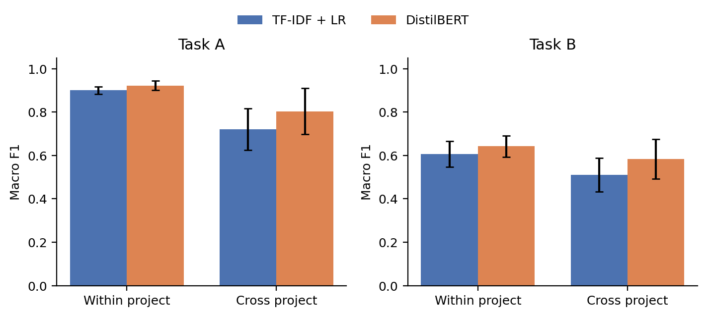

# Fine-Tuned Transformers for Requirements Classification

Requirements engineers spend substantial manual effort separating functional requirements from non-functional ones and tagging each non-functional requirement with its quality type, such as security, performance, or usability. On large programs this triage is slow, varies between reviewers, and is hard to keep traceable as documents change.

This project asks whether a fine-tuned transformer classifies requirements more accurately than a strong classical baseline, where any advantage comes from, and whether it holds on projects the models have never seen.

## Approach

Fine-tuned DistilBERT is compared against TF-IDF with class weighted logistic regression on the PROMISE_exp dataset of 968 requirements from 47 projects. There are two tasks, functional versus non-functional, and classification into eleven non-functional quality types. Both models are tuned and scored on identical repeated cross validation folds, on a held out test set, and on 15 folds in which whole projects are held out. Macro F1 is the headline metric, and corrected resampled t-tests decide four hypotheses. An ablation and a learning curve explain where the differences come from.

## Findings

| Setting | Task | Baseline macro F1 | DistilBERT macro F1 |
|---|---|---|---|
| Within projects | Functional vs non-functional | 0.900 | 0.922 |
| Within projects | Eleven quality types | 0.606 | 0.642 |

- Within projects the transformer's gains are small and, averaged over three training seeds, not statistically significant. They are also not concentrated in the rare quality types.
- On projects held out from training, both models degrade but the baseline degrades more. The transformer's advantage on the eleven class task at least doubles to 0.085 macro F1, is significant, and holds on all 15 project grouped folds.
- Masking project specific vocabulary affects neither model, which points to differences in how projects phrase and label requirements rather than to project names.
- The baseline depends on class weighting far more than the transformer does, and the transformer overtakes the baseline only beyond about 15 labeled examples per class.

The value of pretraining for requirements classification lies mainly in robustness to unseen projects rather than in accuracy on familiar ones.



## Paper

- [Research paper, IEEE conference format (PDF)](paper/Lane-Requirements-Classification-Paper.pdf)

## Repository contents

| Path | Role |
|---|---|
| `Lane-Research-Notebook.ipynb` | The full experiment with outputs, from data loading through the baseline, fine-tuning, statistical tests, ablation, and learning curve |
| `PROMISE_exp.csv` | The PROMISE_exp dataset (Lima et al., SBES 2019), 968 labeled requirements from 47 projects |
| `results/run_cache.json` | Every fine-tuning run, keyed by task, protocol, fold, and configuration |
| `results/summary.json`, `results/robustness.json` | Summary metrics and the robustness experiments reported in the paper |
| `figures/` | Every figure in the paper |
| `paper/` | The final paper as PDF |

## Running it

```
pip install -r requirements.txt
jupyter notebook Lane-Research-Notebook.ipynb
```

The notebook expects `PROMISE_exp.csv` beside it. The transformer experiments use the pretrained `distilbert-base-uncased` checkpoint and a CUDA GPU, and the 178 fine-tuning runs of the main experiment took about 1.5 GPU hours. Because every run is cached in `results/run_cache.json`, rerunning the notebook with this repository's cache reproduces the reported numbers without retraining. Without network access to the checkpoint, the notebook falls back to a small smoke test model so the pipeline still runs end to end.

## Built with

Python, PyTorch, Hugging Face Transformers, scikit-learn, SciPy

## Data

PROMISE_exp was published by Lima, Valle, Cordeiro, and Ferreira at the Brazilian Symposium on Software Engineering (SBES 2019) as an expansion of the original PROMISE NFR dataset. It is included here for reproducibility with credit to its authors.

## Context

Research project for EN.705.742 Advanced Applied Machine Learning at Johns Hopkins University (Fall 2026).
